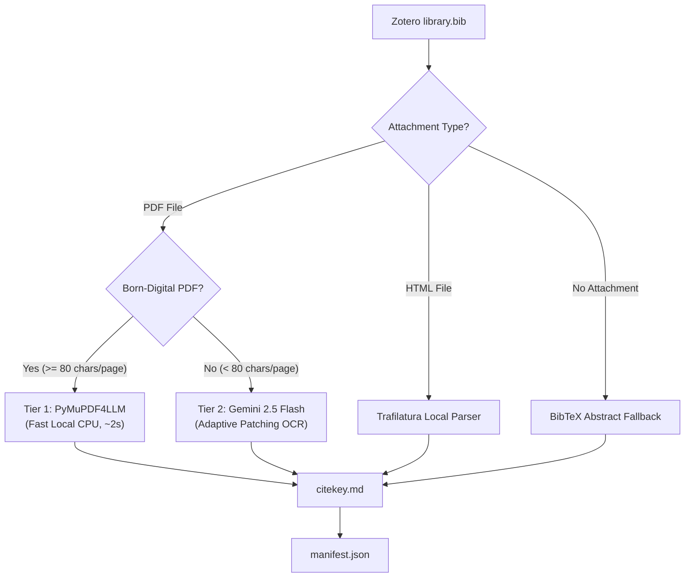

<div align="center">


# mark-lit-down

*A local knowledge-base builder for researchers: convert Zotero libraries into structured Markdown for review, retrieval, and AI workflows.*
**[English]** | [中文](README_zh.md)

</div>

`mark-lit-down` converts a Zotero library into a structured local Markdown database. It reads a BibTeX export file and locates linked PDF and HTML files. Then it extracts clean text and writes normalized Markdown files for RAG pipelines, note systems, or downstream manuscript review systems such as [academic-auto-reviewer](https://github.com/Jidi1997/academic-auto-reviewer).

## What It Does

- Builds a local Markdown literature database from Zotero exports.
- Uses a two-tier extraction engine:
  - **Tier 1 (Local)**: High-speed extraction with `PyMuPDF4LLM` for born-digital PDFs.
  - **Tier 2 (Cloud Fallback)**: Adaptive vision OCR with `Gemini 2.5 Flash` for scanned image PDFs.
  - **Fallback**: HTML extraction and abstract fallback when full text is missing.
- Writes consistent YAML frontmatter for each output file.
- Generates a machine-readable processing manifest (`manifest.json`).
- Preserves the legacy Mistral OCR version in `hst_marklitdown.py`.

## Why This Project

Many research tools manage citations. Few tools convert your literature library into a clean, inspectable, AI-ready local database. `mark-lit-down` focuses on this conversion step.

The output supports three common research tasks:

- Grounded RAG and local literature search.
- Downstream manuscript review workflows.
- Personal knowledge management in Markdown tools like Obsidian.

## Quickstart

1. Export `library.bib` from Zotero.
2. Copy `.env.example` to `.env` and set your local paths and optional API keys.
3. Install dependencies and run the converter:

```bash
git clone https://github.com/Jidi1997/mark-lit-down.git
cd mark-lit-down
pip install -r requirements.txt
cp .env.example .env
python marklitdown.py
```

## Workflow Architecture



## Features

| Feature | Description |
|---|---|
| **Two-Tier Engine** | Local `PyMuPDF4LLM` runs first. `Gemini 2.5 Flash` processes scanned documents with adaptive page slicing. |
| **Normalized frontmatter** | Every output file includes standard YAML keys: `citekey`, `source`, and `status`. |
| **Processing manifest** | Each run generates `manifest.json` to record how the engine processed every entry. |
| **Checkpoint and skip** | The engine identifies and skips existing complete files to save computing time and API quota. |
| **Concurrent processing** | Uses `ThreadPoolExecutor` to process multiple documents in parallel on modern CPUs. |

## Inputs and Outputs

**Primary input**

- A Zotero BibTeX export, usually `library.bib`.

**Expected supporting input**

- Zotero attachment storage with linked PDF and HTML files.
- Optional Google Gemini API key for scanned PDF OCR.

**Generated output**

- One Markdown file per CiteKey (e.g. `Smith2023.md`).
- A `manifest.json` processing report.
- A `missing_log.txt` summary for entries without text.

## Output Schema

Every generated Markdown file uses standard YAML frontmatter:

```markdown
---
citekey: Smith2023
source: pdf pymupdf
status: complete
---

# 1. Introduction
...
```

Valid `source` values:

- `pdf pymupdf`
- `pdf gemini_ocr`
- `pdf ocr` (legacy Mistral)
- `html`
- `abstract`

Valid `status` values:

- `complete`
- `partial`

## Configuration

Set runtime options through environment variables or a `.env` file:

```bash
# Path to your exported Zotero BibTeX library file
BIB_FILE_PATH=./library.bib

# Path to your Zotero storage folder
ZOTERO_STORAGE_PATH=./storage

# Output directory for generated Markdown files
OUTPUT_MD_DIR=./markdown_database/

# Optional Gemini API key for scanned PDF OCR fallback
GEMINI_API_KEY=your_gemini_api_key_here
GEMINI_MODEL=gemini-2.5-flash
GEMINI_PATCH_SIZE=5

# Concurrent worker threads (6 to 8 recommended for Apple Silicon)
MAX_WORKERS=6
```

## Large-Scale Scanned Documents: Batch API Strategy

For processing thousands of scanned PDFs, see the technical memorandum:

- **[docs/BATCH_VLM_OCR_STRATEGY.md](docs/BATCH_VLM_OCR_STRATEGY.md)**: Details on asynchronous Cloud Batch APIs, 50% cost discounts, and mathematical ID reconciliation.

## Ecosystem

`mark-lit-down` serves as the data extraction layer for [academic-auto-reviewer](https://github.com/Jidi1997/academic-auto-reviewer).

- `mark-lit-down` converts literature attachments into local Markdown files.
- `academic-auto-reviewer` reads those files to audit citations and manuscripts.

## FAQ

### Do I need Zotero?

Yes. The workflow reads Zotero BibTeX exports and linked storage attachments.

### Do I need an API key to run this?

No. Born-digital PDFs, HTML files, and abstracts run completely locally with zero API keys. You only need a Gemini API key if you process scanned image PDFs.

### What happens if PDF parsing fails?

The pipeline falls back to HTML extraction when available, and then to the BibTeX abstract.

### Where is the old Mistral OCR version?

The historical version remains archived in `hst_marklitdown.py`.

## License

This project is licensed under the [MIT License](LICENSE).
