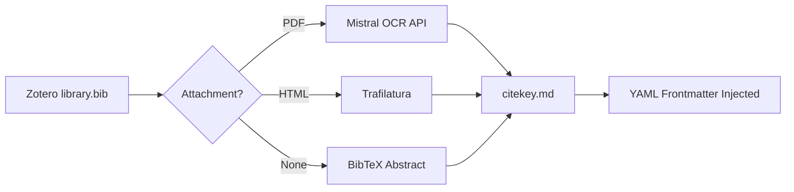

# mark-lit-down

[](LICENSE)

**Convert your Zotero library into an LLM-ready, Obsidian-compatible Markdown knowledge base.**

`mark-lit-down` bridges the gap between academic reference managers and modern AI workflows. It reads a Zotero BibTeX export, locates the corresponding PDF and HTML attachments, converts them into clean Markdown using [Mistral OCR](https://docs.mistral.ai/capabilities/document/), and outputs a structured local database ready for Retrieval-Augmented Generation (RAG) pipelines or personal knowledge management (PKM) tools like [Obsidian](https://obsidian.md/).

---

## Features

| Feature | Description |
|---|---|
| **Mistral Cloud OCR** | Converts complex, dual-column academic PDFs with high fidelity — preserving math, tables, and multi-column layouts. |
| **YAML Frontmatter** | Injects standard YAML metadata (`citekey`, `source`, `status`) into every output file for native Obsidian and downstream RAG compatibility. |
| **Smart Fallback** | PDF → HTML (via Trafilatura) → BibTeX Abstract. Ensures maximum coverage even when full text is unavailable. |
| **Checkpoint & Skip** | Detects existing files with valid frontmatter and skips them automatically. Re-runs never waste API quota on already-processed entries. |
| **Concurrent Processing** | Multi-threaded via `ThreadPoolExecutor`. Processes dozens of papers simultaneously, bounded only by API rate limits. |

---

## How It Works



---

## Prerequisites

- Python 3.9+
- A [Mistral API Key](https://console.mistral.ai/)
- A `.bib` export from [Zotero](https://www.zotero.org/) (the [Better BibTeX](https://retorque.re/zotero-better-bibtex/) plugin is recommended; ensure the export includes linked file paths)

## Installation

```bash
git clone https://github.com/yourusername/mark-lit-down.git
cd mark-lit-down
pip install -r requirements.txt
```

## Configuration

All settings are read from **environment variables**. Set them before running:

```bash
export MISTRAL_API_KEY="your_key_here"
export BIB_FILE_PATH="/path/to/library.bib"
export ZOTERO_STORAGE_PATH="/path/to/Zotero/storage"
export OUTPUT_MD_DIR="/path/to/output/markdown_database/"
export LOG_FILE="/path/to/output/missing_log.txt"
export MAX_WORKERS=6
```

Alternatively, edit the default values directly in `marklitdown.py`.

## Usage

```bash
python marklitdown.py
```

### Example Output

```
==============================================
Initializing Zotero Knowledge Base Engine (Concurrent Workers: 6)
==============================================

[Smith2023]  🚀 PDF located. Initiating Mistral OCR cloud conversion...
  └── [Smith2023] 🎉 Cloud parsing finalized!
[Jones2021]  📄 HTML located. Initiating lightweight local extraction...
[Wang2020]   ⏭️ Intercepted: Valid Mistral frontmatter found. Skipping.
[Doe1999]    ❌ No usable data. Logging to missing entries.

✅ Batch processing complete! 1 missing records written to missing_log.txt
```

---

## Output Format

Each output file is named by its BibTeX citekey (e.g., `Smith2023.md`) and contains standard YAML frontmatter:

```markdown
---
citekey: Smith2023
source: mistral_ocr
status: complete
---

# Abstract
This paper investigates...
```

This format is directly compatible with Obsidian, Logseq, and any Markdown-based RAG pipeline.

---

## ⚠️ API Usage, Cost & Privacy

- **Pricing**: As of March 2026, the Mistral OCR API is **free** for standard usage tiers. Check [Mistral's pricing page](https://mistral.ai/pricing/) for the latest information.
- **Data Retention**: Uploaded documents may be **temporarily retained** on Mistral's servers. If your papers contain sensitive, unpublished, or proprietary research data, evaluate the privacy implications before processing. Consider processing only published literature and keeping unpublished manuscripts local.
- **Rate Limits**: Concurrent requests are bounded by `MAX_WORKERS`. If you encounter HTTP 429 (Too Many Requests) errors, reduce `MAX_WORKERS` to 3–4.

---

## Ecosystem

`mark-lit-down` serves as the **data layer** in a larger academic AI ecosystem.

Once your literature database is built, connect it to [**academic-auto-reviewer**](https://github.com/Jidi1997/academic-auto-reviewer) — a multi-agent, zero-hallucination review workflow that uses local RAG to fact-check and peer-review draft manuscripts.

---

## License

This project is licensed under the [MIT License](LICENSE).
