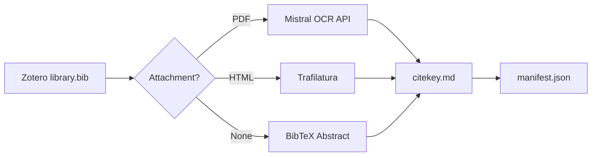

<div align="center">


# mark-lit-down

*A local knowledge-base builder for researchers: convert Zotero libraries into structured Markdown for review, retrieval, and AI workflows.*
**[English]** | [中文](README_zh.md)

</div>

`mark-lit-down` turns a Zotero library into a structured local Markdown database. It reads a BibTeX export, locates linked PDF and HTML attachments, extracts the best available text, and writes normalized Markdown files that can be used by RAG pipelines, note-taking tools, or downstream review systems such as [academic-auto-reviewer](https://github.com/Jidi1997/academic-auto-reviewer).

## What It Does

- Builds a local Markdown literature database from Zotero exports
- Uses a priority pipeline of `PDF OCR -> HTML extraction -> abstract fallback`
- Writes normalized YAML frontmatter for every output file
- Produces a processing manifest for downstream inspection and tooling
- Supports local-first academic workflows for review, retrieval, and PKM

## Why This Project

Many research tools help you manage citations, but fewer tools turn your literature library into a clean, inspectable, AI-ready local database. `mark-lit-down` focuses on that conversion layer.

The output is designed to be useful in three scenarios:

- grounded RAG and local literature search
- downstream manuscript review workflows
- personal knowledge management in Markdown-native tools

## Quickstart

1. Export `library.bib` from Zotero
2. Configure `.env` with your BibTeX path, Zotero storage path, and output directory
3. Run the converter
4. Inspect the generated Markdown files and processing manifest

```bash
git clone https://github.com/Jidi1997/mark-lit-down.git
cd mark-lit-down
pip install -r requirements.txt
cp .env.example .env
python marklitdown.py
```

## Workflow Overview



## Features

| Feature | Description |
|---|---|
| **Priority fallback** | PDF OCR first, then HTML extraction, then abstract-only fallback when full text is unavailable. |
| **Normalized frontmatter** | Every output file includes consistent YAML metadata such as `citekey`, `source`, and `status`. |
| **Processing manifest** | Each run generates a machine-readable `manifest.json` that records how every entry was handled. |
| **Checkpoint and skip** | Existing OCR-complete files are detected and skipped to conserve OCR quota. |
| **Concurrent processing** | Uses `ThreadPoolExecutor` to process multiple papers in parallel. |

## Inputs and Outputs

**Primary input**

- A Zotero BibTeX export, usually `library.bib`

**Expected supporting input**

- Zotero attachment storage with linked PDF and/or HTML files
- Optional Mistral API key for PDF OCR

**Generated output**

- One Markdown file per citekey, for example `Smith2023.md`
- A `manifest.json` processing report
- A `missing_log.txt` summary for unresolved entries

## Output Schema

Every generated Markdown file uses the same YAML schema regardless of extraction route:

```markdown
---
citekey: Smith2023
source: pdf ocr
status: complete
---

# 1. Introduction
...
```

Current `source` values:

- `pdf ocr`
- `html`
- `abstract`

Current `status` values:

- `complete`
- `partial`

This consistency makes the database easier to filter, audit, and reuse in downstream pipelines.

## Quality Boundaries

- PDF OCR quality depends on source document quality and layout complexity.
- HTML extraction depends on the attached page content and publisher markup.
- Abstract fallback is useful for coverage, but it should be treated as lower-fidelity evidence than full text.

## Configuration

All runtime settings are loaded from environment variables or a `.env` file.

```bash
MISTRAL_API_KEY=your_api_key_here
BIB_FILE_PATH=./library.bib
ZOTERO_STORAGE_PATH=./storage
OUTPUT_MD_DIR=./markdown_database/
LOG_FILE=./markdown_database/missing_log.txt
MANIFEST_FILE=./markdown_database/manifest.json
MAX_WORKERS=6
```

For first-time runs, using `MAX_WORKERS=2` or `3` is often safer if you are unsure about OCR rate limits.

## Example Output

```text
==============================================
Initializing Zotero Knowledge Base Engine (Concurrent Workers: 6)
==============================================

[Smith2023]  PDF located. Initiating Mistral OCR cloud conversion...
[Jones2021]  HTML located. Initiating lightweight local extraction...
[Wang2020]   Intercepted: Valid Mistral frontmatter found. Skipping processing to conserve API quota.
[Doe1999]    No usable data. Logging to missing entries.

Batch processing complete! 1 missing records have been written to missing_log.txt
```

## Ecosystem

`mark-lit-down` works well as the data layer for [academic-auto-reviewer](https://github.com/Jidi1997/academic-auto-reviewer).

- `mark-lit-down` standardizes your literature assets into local Markdown files
- `academic-auto-reviewer` uses those files as grounded evidence for citation audit and manuscript review

The two projects can be used independently, but they are designed to work especially well together.

## FAQ

### Do I need Zotero?

The current workflow is built around Zotero-style BibTeX exports and linked attachment storage.

### Do I need Mistral?

Only for PDF OCR. HTML extraction and abstract fallback can still run without a Mistral API key.

### What happens if PDF parsing fails?

The pipeline falls back to HTML extraction when available, and then to the BibTeX abstract if no richer source can be processed.

### Is this only for RAG?

No. The output can also be used for local search, note-taking, or downstream review workflows.

### Can I use this with unpublished or sensitive documents?

Be careful. OCR providers may temporarily retain uploaded documents. Review the provider's privacy policy before processing sensitive files.

## License

This project is licensed under the [MIT License](LICENSE).
