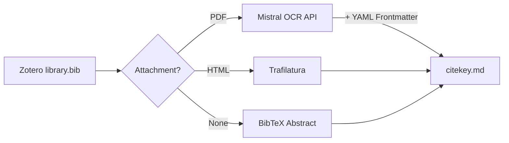

<div align="center">


# mark-lit-down

<p align="center">
  
  
  
  
</p>

*A pipeline that converts Zotero libraries into structured, RAG-ready Markdown — with smart fallback, concurrent processing, and zero re-processing overhead.*

</div>

`mark-lit-down` bridges the gap between academic reference managers and modern AI workflows. It reads a Zotero BibTeX export, locates the corresponding PDF and HTML attachments, converts them into clean Markdown using [Mistral OCR](https://docs.mistral.ai/capabilities/document/), and outputs a structured local database ready for Retrieval-Augmented Generation (RAG) pipelines or personal knowledge management (PKM) tools like [Obsidian](https://obsidian.md/).

(Note: While Mistral OCR is the default, the implementation is pluggable for other models like Gemini 1.5/2.0, GPT-4o, or tools like PaddleOCR, olmOCR, MinerU, and Tesseract.)

---

## Features

| Feature | Description |
|---|---|
| **Smart Fallback** | PDF → HTML (via Trafilatura) → BibTeX Abstract. Ensures maximum coverage even when full text is unavailable. |
| **Mistral OCR** | Converts complex, dual-column academic PDFs with high fidelity — preserving math, tables, and multi-column layouts. |
| **YAML Frontmatter** | Injects standard YAML metadata (`citekey`, `source`, `status`) into every output file for native Obsidian and downstream RAG compatibility. |
| **Checkpoint & Skip** | Detects existing files with valid frontmatter and skips them automatically. Re-runs never waste API quota on already-processed entries. |
| **Concurrent Processing** | Multi-threaded via `ThreadPoolExecutor`. Processes dozens of papers simultaneously, bounded only by API rate limits. |

---

## How It Works



---

## Prerequisites

- Python 3.9+
- A [Mistral API Key](https://console.mistral.ai/) (*Required for PDF OCR; HTML and abstract fallbacks function without an API key*)
- A `.bib` export from [Zotero](https://www.zotero.org/) (the [Better BibTeX](https://retorque.re/zotero-better-bibtex/) plugin is recommended; ensure the export includes linked file paths)

## Installation

```bash
git clone https://github.com/yourusername/mark-lit-down.git
cd mark-lit-down
pip install -r requirements.txt
```

## Configuration

All settings are read from **environment variables** or a **`.env` file**. 

1. Copy the example template:
   ```bash
   cp .env.example .env
   ```
2. Open `.env` and fill in your specific paths and API key:
   ```bash
   MISTRAL_API_KEY="your_key_here"      # PDF OCR
   BIB_FILE_PATH="/path/to/library.bib" # Zotero export
   # ... and other variables
   ```

The script will automatically detect and load these settings at runtime.
## Usage

```bash
python marklitdown.py
```

### Example Output

```
==============================================
Initializing Zotero Knowledge Base Engine (Concurrent Workers: 6)
==============================================

[Smith2023]  [PDF → OCR] ... done
[Jones2021]  [HTML → MD] ... done
[Wang2020]   [SKIPPED] (Valid frontmatter found)
[Doe1999]    [MISSING] (No usable data — logged)

✅ Batch processing complete! 1 missing records written to missing_log.txt
```

---

## Output Format

Each output file is named by its BibTeX citekey (e.g., `Smith2023.md`) and contains standard YAML frontmatter:

```markdown
---
citekey: Smith2023
source: mistral_ocr
status: complete
---

# Abstract
This paper investigates the relationship between...

# 1. Introduction
Academic research has long suggested that...

# 2. Methodology
We apply a Difference-in-Differences (DID) approach combined with...

# 3. Results
The empirical findings demonstrate a significant positive association between...

# 4. Conclusion
In summary, this study provides evidence that...
```

This format is directly compatible with Obsidian, Logseq, and any Markdown-based RAG pipeline.

---

## API Usage & Privacy Notes

- **Pricing**: As of March 2026, the Mistral OCR API is **free** for standard usage tiers. Check [Mistral's pricing page](https://mistral.ai/pricing/) for the latest information.
- **Data Retention**: Uploaded documents may be **temporarily retained** on Mistral's servers. If your papers contain sensitive, unpublished, or proprietary research data, evaluate the privacy implications before processing. Consider processing only published literature and keeping unpublished manuscripts local.
- **Rate Limits**: Concurrent requests are bounded by `MAX_WORKERS`. If you encounter HTTP 429 (Too Many Requests) errors, reduce `MAX_WORKERS` to 3–4.

---

## Ecosystem

`mark-lit-down` serves as the **data layer** in a larger academic AI ecosystem.
Once your literature database is built, connect it to [**academic-auto-reviewer**](https://github.com/Jidi1997/academic-auto-reviewer) — a multi-agent review workflow. The Markdown files produced here serve as the grounded truth-source for the `auditor` agent, enabling fact-checking and automated peer review without live web access.

---

## License

This project is licensed under the [MIT License](LICENSE).
