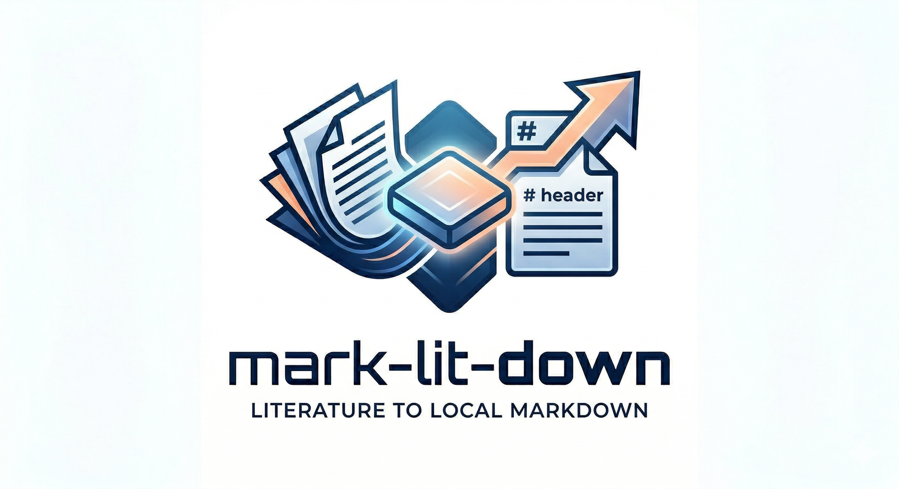
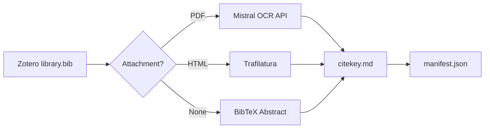

<div align="center">



# mark-lit-down

*一套面向研究者的本地知识库构建器：将 Zotero 文献库转换为结构化 Markdown，用于审阅、检索与 AI 工作流。*

[English](README.md) | **[中文]**

</div>

`mark-lit-down` 可以把 Zotero 文献库转换为结构化的本地 Markdown 数据库。它读取 BibTeX 导出文件，定位关联的 PDF 和 HTML 附件，提取最佳可用文本，并输出标准化 Markdown 文件，供 RAG、笔记系统或下游审阅系统使用，例如 [academic-auto-reviewer](https://github.com/Jidi1997/academic-auto-reviewer)。

## 它能做什么

- 从 Zotero 导出构建本地 Markdown 文献数据库
- 按 `PDF OCR -> HTML 提取 -> 摘要回退` 的优先顺序提取内容
- 为每个输出文件写入统一的 YAML frontmatter
- 生成可供下游工具读取的处理清单 `manifest.json`
- 支持本地优先的学术审阅、检索与知识管理工作流

## 为什么做这个项目

很多研究工具能帮你管理引用，但能把文献库真正转换成“干净、可检查、可被 AI 使用的本地数据库”的工具并不多。`mark-lit-down` 关注的正是这一层转换能力。

这份输出主要适用于三类场景：

- grounded RAG 和本地文献检索
- 下游学术稿件审阅工作流
- Markdown 原生的个人知识管理系统

## 快速开始

1. 从 Zotero 导出 `library.bib`
2. 在 `.env` 中配置 BibTeX 路径、Zotero storage 路径和输出目录
3. 运行转换脚本
4. 检查生成的 Markdown 文件和处理清单

```bash
git clone https://github.com/Jidi1997/mark-lit-down.git
cd mark-lit-down
pip install -r requirements.txt
cp .env.example .env
python marklitdown.py
```

## 工作流概览



## 核心特性

| 特性 | 说明 |
|---|---|
| **优先级回退机制** | 优先 PDF OCR，其次 HTML 提取，最后在没有全文时回退到摘要。 |
| **统一 frontmatter** | 所有输出文件都包含一致的 YAML 元数据，如 `citekey`、`source` 和 `status`。 |
| **处理清单** | 每次运行都会生成机器可读的 `manifest.json`，记录每条文献最终如何被处理。 |
| **断点跳过** | 已经完成 OCR 的文件会被识别并跳过，避免重复消耗 OCR 配额。 |
| **并发处理** | 基于 `ThreadPoolExecutor` 并行处理多篇文献。 |

## 输入与输出

**主要输入**

- 一个 Zotero BibTeX 导出文件，通常是 `library.bib`

**预期辅助输入**

- 带有 PDF 和/或 HTML 附件的 Zotero storage
- 可选的 Mistral API key，用于 PDF OCR

**生成输出**

- 每个 citekey 对应一个 Markdown 文件，例如 `Smith2023.md`
- 一份 `manifest.json` 处理清单
- 一份 `missing_log.txt` 缺失条目日志

## 输出 Schema

无论最终走的是哪条提取路径，生成的 Markdown 文件都使用同样的 YAML schema：

```markdown
---
citekey: Smith2023
source: pdf ocr
status: complete
---

# 1. Introduction
...
```

当前 `source` 取值：

- `pdf ocr`
- `html`
- `abstract`

当前 `status` 取值：

- `complete`
- `partial`

这种一致性会让数据库更容易被过滤、审计和复用于下游流程。

## 质量边界

- PDF OCR 的质量取决于源文件清晰度和版式复杂度。
- HTML 提取效果取决于附件页面内容和 publisher 的标记质量。
- 摘要回退能提升覆盖率，但其证据强度通常低于全文。

## 配置

所有运行时设置都来自环境变量或 `.env` 文件。

```bash
MISTRAL_API_KEY=your_api_key_here
BIB_FILE_PATH=./library.bib
ZOTERO_STORAGE_PATH=./storage
OUTPUT_MD_DIR=./markdown_database/
LOG_FILE=./markdown_database/missing_log.txt
MANIFEST_FILE=./markdown_database/manifest.json
MAX_WORKERS=6
```

如果是第一次运行，且不确定 OCR 限速情况，通常建议先把 `MAX_WORKERS` 设为 `2` 或 `3`。

## 输出示例

```text
==============================================
Initializing Zotero Knowledge Base Engine (Concurrent Workers: 6)
==============================================

[Smith2023]  PDF located. Initiating Mistral OCR cloud conversion...
[Jones2021]  HTML located. Initiating lightweight local extraction...
[Wang2020]   Intercepted: Valid Mistral frontmatter found. Skipping processing to conserve API quota.
[Doe1999]    No usable data. Logging to missing entries.

Batch processing complete! 1 missing records have been written to missing_log.txt
```

## 生态协同

`mark-lit-down` 很适合作为 [academic-auto-reviewer](https://github.com/Jidi1997/academic-auto-reviewer) 的数据层。

- `mark-lit-down` 负责把文献资产标准化为本地 Markdown 文件
- `academic-auto-reviewer` 负责把这些文件作为 grounded evidence，用于引用核查和稿件审阅

这两个项目可以独立使用，但组合在一起时协同效果最好。

## 常见问题

### 必须使用 Zotero 吗？

当前工作流是围绕 Zotero 风格的 BibTeX 导出和附件存储结构设计的。

### 必须使用 Mistral 吗？

只有 PDF OCR 需要。即使没有 Mistral API key，HTML 提取和摘要回退仍然可以运行。

### 如果 PDF 解析失败怎么办？

流程会在有条件时回退到 HTML 提取；如果没有可用的 HTML，则进一步回退到 BibTeX 摘要。

### 它只适用于 RAG 吗？

不是。输出同样可以用于本地检索、笔记整理和下游稿件审阅工作流。

### 可以用于未发表或敏感文档吗？

需要谨慎。OCR 提供商可能会暂时保留上传文件，因此在处理敏感材料前应先确认其隐私政策。

## 许可

本项目基于 [MIT License](LICENSE) 发布。
