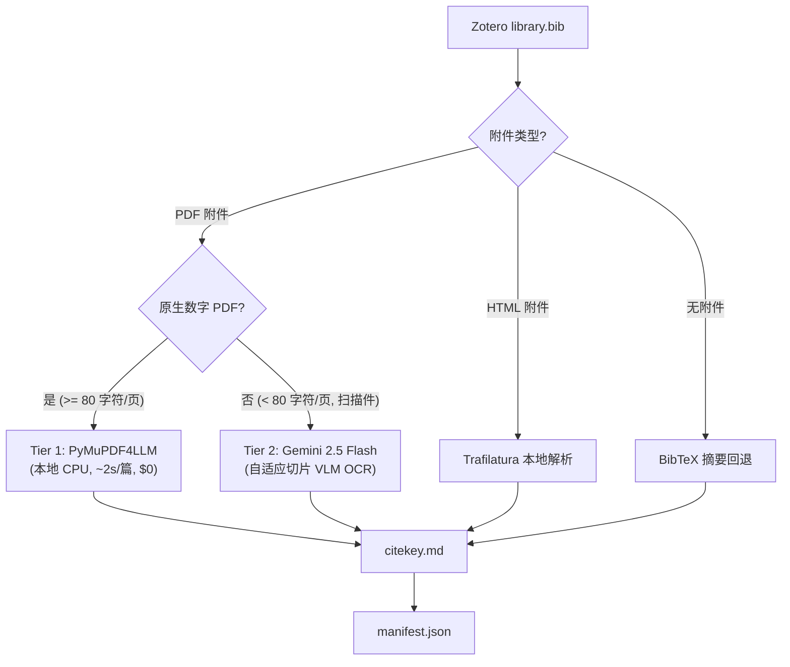

<div align="center">


# mark-lit-down

*一套面向研究者的本地知识库构建器：将 Zotero 文献库转换为结构化 Markdown，用于审阅、检索与 AI 工作流。*

[English](README.md) | **[中文]**

</div>

`mark-lit-down` 可以把 Zotero 文献库转换为结构化的本地 Markdown 数据库。它读取 BibTeX 导出文件，定位关联的 PDF 和 HTML 附件，提取高质量文本，并输出标准化 Markdown 文件，供 RAG、笔记系统（如 Obsidian）或下游学术审阅系统（例如 [academic-auto-reviewer](https://github.com/Jidi1997/academic-auto-reviewer)）使用。

## 它能做什么

- 从 Zotero 导出构建本地 Markdown 文献数据库。
- 采用**双层自适应提取引擎**：
  - **Tier 1 (本地优先)**：对原生数字 PDF 采用 `PyMuPDF4LLM` 进行极速、零成本提取（单篇约 1~2 秒，零大模型幻觉）。
  - **Tier 2 (云端兜底)**：对纯图片/扫描件 PDF 自动调用 `Gemini 2.5 Flash` 多模态视觉 OCR（自适应分块切片，突破 8k 输出限制）。
  - **兜底链路**：无 PDF 时回退到 HTML 提取，无全文时回退到 BibTeX 摘要。
- 为每个输出文件写入统一且兼容 Obsidian 的 YAML frontmatter。
- 生成机器可读的处理清单 `manifest.json`，支持 100% 账目对齐与重试。
- 归档保留历史 Mistral OCR 版本于 `hst_marklitdown.py`。

## 为什么做这个项目

很多研究工具能帮你管理引用，但能把文献库真正转换成“干净、可检查、可被 AI 使用的本地数据库”的工具并不多。`mark-lit-down` 关注的正是这一层转换能力。

输出主要适用于三类场景：

- Grounded RAG 和本地文献检索。
- 下游学术稿件审阅工作流。
- Markdown 原生的个人知识管理系统（PKM）。

## 快速开始

1. 从 Zotero 导出 `library.bib`。
2. 复制 `.env.example` 为 `.env`，配置本地路径及可选的 API Key。
3. 安装依赖并运行转换脚本：

```bash
git clone https://github.com/Jidi1997/mark-lit-down.git
cd mark-lit-down
pip install -r requirements.txt
cp .env.example .env
python marklitdown.py
```

## 工作流架构



## 核心特性

| 特性 | 说明 |
|---|---|
| **双层自适应引擎** | 本地 `PyMuPDF4LLM` 优先，速度极快且实证表格零幻觉；扫描件无缝转入 `Gemini 2.5 Flash`。 |
| **统一 frontmatter** | 所有输出文件都包含统一的 YAML 元数据：`citekey`、`source` 和 `status`。 |
| **处理清单与审计** | 每次运行都会生成机器可读的 `manifest.json`，清晰记录每篇文献的解析路径。 |
| **断点跳过** | 自动识别已完成解析的条目并跳过，节省计算时间与 API 配额。 |
| **并发处理** | 基于 `ThreadPoolExecutor` 并行处理多篇文献，充分释放现代多核 CPU 性能。 |

## 输入与输出

**主要输入**

- 一个 Zotero BibTeX 导出文件，通常是 `library.bib`。

**预期辅助输入**

- 带有 PDF 和/或 HTML 附件的 Zotero storage。
- 可选的 Google Gemini API Key（仅在处理扫描版 PDF 时需要）。

**生成输出**

- 每个 citekey 对应一个 Markdown 文件（例如 `Smith2023.md`）。
- 一份 `manifest.json` 处理清单。
- 一份 `missing_log.txt` 缺失条目日志。

## 输出 Schema

无论最终走的是哪条提取路径，生成的 Markdown 文件都使用同样的 YAML schema：

```markdown
---
citekey: Smith2023
source: pdf pymupdf
status: complete
---

# 1. Introduction
...
```

当前 `source` 取值：

- `pdf pymupdf`
- `pdf gemini_ocr`
- `pdf ocr` (历史 Mistral 版本)
- `html`
- `abstract`

当前 `status` 取值：

- `complete`
- `partial`

## 配置说明

所有运行时配置均从环境变量或 `.env` 文件中加载：

```bash
# 导出的 Zotero BibTeX 库文件路径
BIB_FILE_PATH=./library.bib

# Zotero storage 附件目录
ZOTERO_STORAGE_PATH=./storage

# 生成的 Markdown 文件存放目录
OUTPUT_MD_DIR=./markdown_database/

# 可选：扫描件 OCR 所需的 Gemini 配置
GEMINI_API_KEY=your_gemini_api_key_here
GEMINI_MODEL=gemini-2.5-flash
GEMINI_PATCH_SIZE=5

# 本地多线程并发数（Apple Silicon 推荐 6~8）
MAX_WORKERS=6
```

## 大规模扫描件处理：云端 Batch API 方案

如果面对数千篇历史纸质扫描件（本地运行极其耗时且发热严重），建议采用异步批处理方案：

- 详见技术备忘录：**[docs/BATCH_VLM_OCR_STRATEGY.md](docs/BATCH_VLM_OCR_STRATEGY.md)**，包含离线打包、20篇抽检法则、半价 Batch API 调度及 100% 账目对齐方案。

## 生态协同

`mark-lit-down` 可以作为 [academic-auto-reviewer](https://github.com/Jidi1997/academic-auto-reviewer) 的数据基础设施：

- `mark-lit-down` 负责将文献附件转化为结构化 Markdown。
- `academic-auto-reviewer` 读取这些文件作为实证证据，完成引用核查与稿件审阅。

## 常见问题

### 运行必须安装 Zotero 吗？

只要有从 Zotero 导出的 `library.bib` 和对应的附件文件夹即可运行，不需要常驻打开 Zotero 桌面端。

### 运行需要付费 API Key 吗？

不需要。绝大多数现代学术文献（95% 以上）均为原生数字 PDF，本地 `PyMuPDF4LLM` 完全免费且离线完成。只有遇到老旧纯图片扫描件时，才需要配置可选的 Gemini API Key。

### 历史版本的 Mistral OCR 还在吗？

已完整保留归档在 `hst_marklitdown.py` 中。

## 开源协议

本项目采用 [MIT License](LICENSE) 开源。
