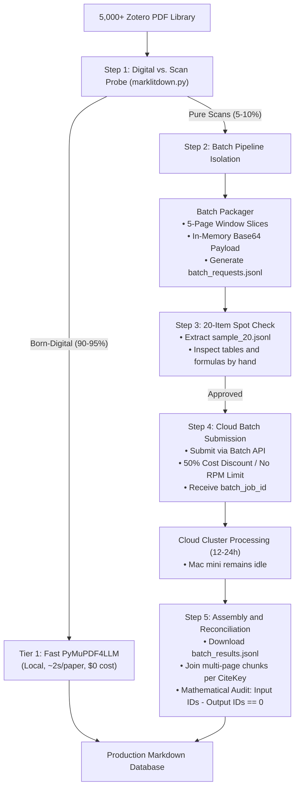

# Technical Memorandum: Large-Scale Scanned PDF Ingestion via Cloud VLM Batch API

**To**: Research Lead / Data Architecture Team  
**From**: Antigravity Technical Architecture Group  
**Date**: November 1, 2026  
**Subject**: Production Strategy for Parsing Scanned Academic PDFs via Cloud VLM Batch API on Apple Silicon Hardware (Mac mini M4, 24GB RAM)

---

## 1. Executive Summary and Problem Statement

When researchers build literature databases of 2,000 to 5,000 papers, they encounter legacy scanned documents. These include old journal scans, government archives, and historical working papers.

Born-digital papers have native text layers. You can extract their text cleanly in two seconds with `PyMuPDF4LLM`. In contrast, raster scans lack font glyph layers. They require Vision-Language Model (VLM) optical document recognition.

Processing thousands of scanned papers (50,000 to 150,000 pages) creates three operational bottlenecks:

1. **Local Hardware Bottlenecks**: Local 7B to 14B vision models need 3 to 6 seconds per page on an M4 Mac mini (24GB RAM). Running 100,000 pages locally demands 120 to 180 hours of continuous GPU load. This workload causes thermal throttling and system lockups.
2. **Synchronous API Limits**: Live API requests hit HTTP 429 rate limits. Long interactive agent sessions also suffer context window saturation. The agent then skips files quietly while reporting completion.
3. **Budget Inflation**: Synchronous calls cost full retail rates. Network disconnects can drop requests in flight.

**The Solution**: An asynchronous **Cloud VLM Batch API Pipeline**. The researcher prepares an offline `.jsonl` manifest, tests a **20-sample spot check**, and submits the job. Cloud batch providers give a **50% discount with zero rate limits**. The researcher reconciles output identifiers after completion.

---

## 2. Quantitative Comparison: Local vs. Synchronous vs. Batch API

| Metric | Pure Local VLM (MinerU / Qwen2-VL) | Synchronous Cloud API (Gemini / Claude) | **Cloud VLM Batch API (Gemini Flash / Claude Batch)** |
| :--- | :--- | :--- | :--- |
| **Compute Location** | Local M4 Mac mini GPU / Neural Engine | Cloud inference stream | Cloud batch cluster |
| **Local Machine State** | Full GPU load for 5 to 7 days, 20 GB RAM used, fans at maximum speed | Low RAM use, but the terminal process must stay open | **Idle (<200 MB RAM)**. The user can close the machine or run regressions |
| **Duration (5,000 Papers)** | 120 to 200 continuous hours | 2 to 4 days (rate-limited by RPM caps) | **12 to 24 hours** (processed in parallel across cloud clusters) |
| **Financial Cost** | $0 (causes machine heat and wear) | ~$10 to $25 (Gemini) / $150+ (Claude / GPT-4o) | **50% Discount**: **~$5 to $12 total (Gemini)** |
| **Failure and Retry Risk** | Out-of-memory crash. Manual restart needed | Network drops or rate limits cause lost requests | **Zero network drops**. Cloud schedulers retry failed requests |
| **Auditability** | Manual directory inspection | Fragile terminal log inspection | **Deterministic JSONL mapping** with complete ID reconciliation |

---

## 3. End-to-End System Architecture



---

## 4. Four-Phase Operational Workflow for Mac mini (M4, 24GB)

### Phase 1: Local Pre-flight Filtering and Chunk Packaging
Filter documents locally before sending data to cloud APIs. **Never send born-digital PDFs to an OCR model**.

1. **Probe**: Run `is_born_digital_pdf()`. The engine sends documents with native text layers to local `PyMuPDF4LLM` and writes Markdown immediately.
2. **Adaptive Chunking for Scans**: Do not pass a 60-page scan in one prompt. That exceeds the model output limit (8,192 tokens). Generate in-memory slices of **4 to 5 pages**.
3. **Format**: Record each slice as one JSON line in `batch_requests.jsonl`:
   ```json
   {
     "custom_id": "Smith2005_chunk_001",
     "method": "POST",
     "url": "/v1beta/models/gemini-2.5-flash:generateContent",
     "body": {
       "contents": [
         {
           "parts": [
             {"inline_data": {"mime_type": "application/pdf", "data": "<BASE64_BYTES>"}},
             {"text": "Transcribe this academic page slice into clean GitHub Flavored Markdown. Preserve regression tables, footnotes, and LaTeX formulas ($...$). Output only markdown."}
           ]
         }
       ]
     }
   }
   ```

### Phase 2: The 20-Item Spot Check (Quality Gate)
Do not submit a 5,000-item batch without testing.

* Save the first 20 lines into `sample_batch.jsonl`.
* Run the sample batch and inspect the output.
* **Manual Inspection Checklist**:
  - Does the model keep parentheses around standard errors `(0.045)` below regression coefficients?
  - Does the model preserve significance asterisks (`***`, `**`, `*`) without italic markup?
  - Does the model format math variables with `$...$` delimiters?
  - Does the model keep correct reading order across two text columns?

### Phase 3: Asynchronous Cloud Submission
After you approve the sample, submit the batch with a Python script:

```python
# Conceptual Submission using Google GenAI SDK
from google import genai

client = genai.Client()
batch_job = client.batches.create(
    model="models/gemini-2.5-flash",
    src="batch_requests.jsonl",
    config={"display_name": "zotero_scanned_literature_batch"}
)
print(f"Batch dispatched. Job ID: {batch_job.name}")
```

* **Hardware Protection**: The local script terminates immediately. Mac mini CPU, GPU, and RAM return to idle. The researcher can run other tasks or power off the machine.

### Phase 4: Output Assembly and Mathematical Reconciliation
When the job finishes (usually in 6 to 18 hours):

1. **Download**: Download `batch_results.jsonl`.
2. **Assembly**: A local script groups slices by CiteKey, joins text chunks in order, and writes YAML frontmatter:
   ```yaml
   ---
   citekey: Smith2005
   source: pdf gemini_batch_ocr
   status: complete
   batch_job_id: batches/9482019482
   ---
   ```
3. **Mathematical Audit (Check Zero Lost Records)**:
   ```python
   input_keys = set(entry['ID'] for entry in bib_database.entries if is_scan(entry))
   output_keys = set(f.stem for f in Path("markdown_database").glob("*.md"))
   
   missing = input_keys - output_keys
   assert len(missing) == 0, f"Audit Failed! {len(missing)} papers missing: {missing}"
   ```

---

## 5. Economic Feasibility Analysis for 5,000 Scanned Papers

Consider an extreme test where all 5,000 papers are scans (averaging 20 pages per paper, or 100,000 total pages):

* **Input Size**: 100,000 pages $\times$ ~300 tokens/page $\approx$ **30,000,000 tokens**.
* **Output Size**: 100,000 pages $\times$ ~400 tokens/page $\approx$ **40,000,000 tokens**.
* **Gemini 2.5 Flash Batch Pricing** (50% discount):
  - Batch Input: \$0.0375 / 1M tokens $\rightarrow$ \$1.12
  - Batch Output: \$0.15 / 1M tokens $\rightarrow$ \$6.00
  - **Estimated Total Cost for 5,000 Scanned Papers**: **~\$7.12 USD**.

> [!TIP]
> **Key Conclusion**: For less than \$10 USD total, you can convert 5,000 scanned papers into Markdown within 24 hours. This workflow removes more than 180 hours of heavy local GPU load from your Mac mini.

---

## 6. Recommended Action Items for mark-lit-down

1. **Current Production State**: [marklitdown.py](../marklitdown.py) processes daily incremental workflows using **Tier 1 (PyMuPDF4LLM)** and **Tier 2 (Gemini Real-time Adaptive Patching)**.
2. **Batch Expansion**: When you import large scanned archives (>500 scanned PDFs at once), use the offline batch scripts from Section 4.
